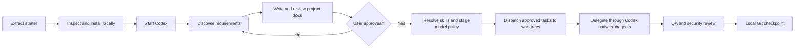
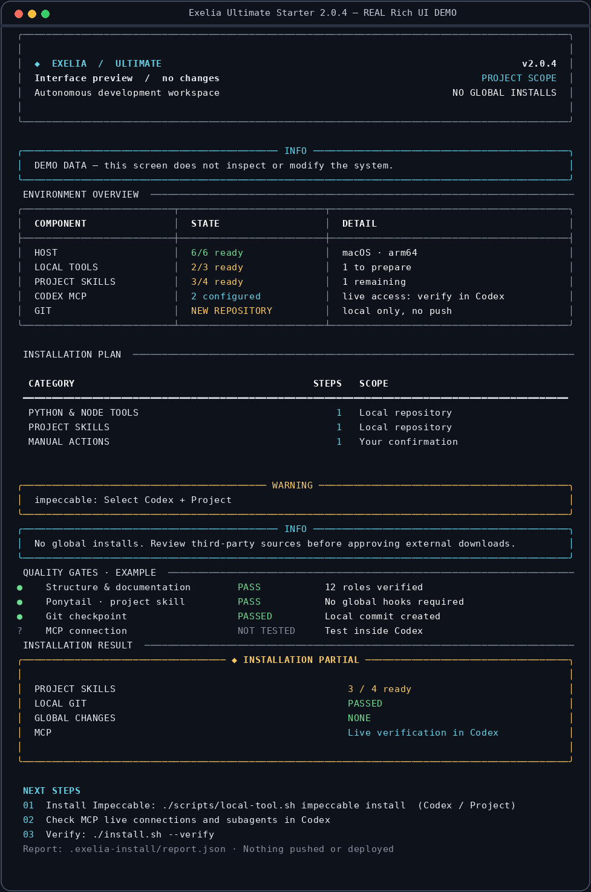

# Exelia Ultimate Codex Starter

**A project-local development environment for building new applications with Codex CLI.**

[Getting started](START_HERE.md) · [First project prompt](START_NEW_PROJECT.md) · [Resume a project](CONTINUE_PROJECT.md) · [Troubleshooting](docs/installer/TROUBLESHOOTING.md) · [Security policy](docs/installer/SECURITY.md) · [Automation](docs/automation/README.md) · [GitHub template setup](docs/GITHUB_SETUP.md)

> [!IMPORTANT]
> **Everything Exelia installs belongs to the current project.** Host applications such as Codex CLI, Git, Node.js, Python and OrbStack must already be available. Exelia will inspect them, but will not change global packages, plugins or user configuration.

## At a glance

| Capability | What you get |
| :--- | :--- |
| **Guided project discovery** | Requirements interview, architecture, risk analysis and 14 English project documents |
| **One-time approval** | The user approves project documentation before application implementation begins |
| **12 specialist agents** | Product, architecture, frontend, backend, database, UI/UX, DevOps, QA, security, review and documentation roles |
| **Project-local setup** | Skills, Node CLIs and Python tools isolated under the repository |
| **Repeatable Git delivery** | Local baseline commit, gated checkpoints, no automatic push |
| **Rich installer** | Bundled Rich interface from first frame, with plain fallback and UI demo |
| **2.1 capability resolver** | Chooses skills from the approved stack; core skills only before discovery |
| **Dependency-aware worktrees** | Prepare independent task worktrees, check overlap and integrate only after review |
| **QA, visual QA and evaluation** | Strict stack-driven test gates, optional Playwright smoke checks, actual agent metrics |
| **GitHub template ready** | Publication documentation, license, contributing and CI smoke checks |

## The complete workflow



> [!NOTE]
> The starter's documentation templates intentionally contain `TBD` values. The application quality gate must remain blocked until discovery is complete and approval has been recorded.

## Terminal interface preview

The installer renders a Rich dashboard **from the first invocation**. This screenshot
was generated from the **actual `--ui-demo` renderer** with labeled example data,
not from the user's Mac or a design mockup. Try it before installation:

```bash
./install.sh --ui-demo
```



`--plan` shows your real discovered environment. Use `--verbose` when you need
individual tool versions, every skill and detailed install commands.

## Start a new project in four steps

**1. Extract** this complete archive into a new, empty folder. Preserve hidden directories such as `.codex` and `.agents`.

**2. Inspect** the environment and the proposed changes:

```bash
./install.sh --check
./install.sh --plan
```

Both commands are read-only. Run `./install.sh --ui-demo` to see the actual full Rich layout without installing anything.

**3. Install and verify** project-scoped dependencies:

```bash
./install.sh --apply
./install.sh --verify
```

`--apply` asks for confirmation before installing. If the outcome is `PARTIAL`, follow the specific next-action message; it does not necessarily mean that the core setup failed. See [installation troubleshooting](docs/installer/TROUBLESHOOTING.md).

**4. Launch Codex**, then paste the text from [`START_NEW_PROJECT.md`](START_NEW_PROJECT.md):

```bash
cat START_NEW_PROJECT.md | pbcopy  # macOS only
codex
```

> [!TIP]
> The very first question asks whether you want to communicate in **Polish or English**. Code, technical documentation, agent instructions and tests remain **English**. The application's own UI languages are chosen separately during discovery.

A complete, step-by-step walkthrough is in **[START_HERE.md](START_HERE.md)**.

## Where things live

```text
exelia-ultimate-starter/
├── .agents/skills/          # Project skills, including local Ponytail
├── .codex/
│   ├── agents/               # Twelve specialist role definitions
│   ├── config.toml           # Project MCP and agent settings
│   └── hooks/                # Exelia's own project-state reminder
├── .exelia-tools/            # Local Node/Python CLIs (created on install; Git-ignored)
├── docs/
│   ├── installer/            # Installation, recovery and safety guides
│   ├── project/              # Application docs populated during discovery
│   ├── standards/            # Project engineering and delivery standards
│   └── templates/            # Reusable documentation templates
├── tasks/                    # State and task ledger
├── AGENTS.md                 # Project-wide agent instructions
├── START_HERE.md             # Human installation walkthrough
├── START_NEW_PROJECT.md      # Prompt to paste when starting work
└── CONTINUE_PROJECT.md       # Prompt to resume an existing project
```

`.exelia-tools/` and `.exelia-install/` contain machine-local dependencies and run logs; they are excluded from version control.

## Installation boundaries

| Component | Scope | Notes |
| :--- | :--- | :--- |
| External skills | `.agents/skills/<name>/` | Copies, not links to global skills |
| Skills / Playwright / Impeccable CLIs | `.exelia-tools/node/` | Installed with a repository-specific npm prefix |
| Python tools (`uv`, optional `ruff`) | `.exelia-tools/python/` | Isolated Python environment |
| Installer Rich UI and dependencies | `installer/_vendor/` | Bundled with the ZIP; usable offline on first run |
| Context7 and OpenAI Docs MCP | `.codex/config.toml` | Configuration does **not** prove connectivity |
| Ponytail | `.agents/skills/ponytail/SKILL.md` | Skill guidance only, **not** global plugin hooks |
| Git identity and baseline | Current repository | Local commits only; never automatically pushed |
| Codex CLI, Node, Python, Git, container runtime | Host | Detected, never installed globally by the starter |

> [!WARNING]
> **Ponytail skill vs Ponytail plugin:** Exelia uses the local **skill**. A separately installed global Ponytail plugin may still request hook trust; that is not required to use this starter. See [Ponytail modes and hooks](docs/installer/PONYTAIL.md).

## Command reference

| Command | When to use it |
| :--- | :--- |
| `./install.sh --check` | Check the machine and project without writing anything |
| `./install.sh --plan` | Preview local installations and manual actions |
| `./install.sh --apply` | Approve and install missing project-scoped components |
| `./install.sh --verify` | Re-check setup; does not prove live agent or MCP behavior |
| `./install.sh --resume` | Finish interrupted or manually completed installation |
| `./install.sh --repair` | Retry missing or broken local components |
| `./install.sh --report` | Display the latest installation report |
| `./install.sh --rollback` | Restore supported, installer-backed-up local configuration |
| `./install.sh --plan --json` | Export the plan for scripts, without changes |
| `./install.sh --plan --verbose` | Show detailed planned commands |

For a fully specified local Git identity in an unattended setup (only if you understand the plan):

```bash
./install.sh --apply --yes --git-name "Developer" --git-email "dev@example.test"
```

### Optional manual step: Impeccable

If the result mentions a missing **Impeccable skill**, its CLI and its skill are separate components. Use:

```bash
./scripts/local-tool.sh impeccable install
```

Select **Codex → Project**, not Global; then rerun:

```bash
./install.sh --resume
./install.sh --verify
```

### Quality verification

```bash
python3 scripts/validate-starter.py
python3 -m unittest discover -s tests -v
python3 tests/integration_smoke.py
```

These tests cover the starter structure and simulated installation. Real package downloads, Codex delegation, MCP authentication and a live OrbStack execution environment require separate checks on the destination machine.

## Documentation map

| You want to… | Read |
| :--- | :--- |
| Install for the first time | [Start here](START_HERE.md) |
| Understand the implementation workflow | [Engineering workflow](docs/standards/WORKFLOW.md) |
| Troubleshoot `PARTIAL`, skills or MCP | [Troubleshooting](docs/installer/TROUBLESHOOTING.md) |
| Understand local Ponytail and hook trust | [Ponytail](docs/installer/PONYTAIL.md) |
| Review platform requirements | [Platforms](docs/installer/PLATFORMS.md) |
| Restore local configuration | [Rollback](docs/installer/ROLLBACK.md) |
| Learn Rich status meanings | [Terminal UI](docs/installer/TERMINAL_UI.md) |
| Review the security model | [Security](docs/installer/SECURITY.md) |
| Review changes and limitations | [Changelog](CHANGELOG.md) · [Audit](AUDIT_REPORT.md) |

---

**Version 2.1.0 · Intelligent development foundation.** Rich is bundled locally and used from the first frame; compact dashboards replace repeated lists. No global installations.

## GitHub-ready workflow (2.1)

To publish this starter once, follow [GitHub setup](docs/GITHUB_SETUP.md). For each new app use GitHub **Use this template**, then clone that app's separate repository. Plain cloning the starter directly retains its `origin` and should be used to contribute to the starter itself.

After installing core tools, select a technology stack during discovery; only then run `./install.sh --resume` to install project-specific skills. The complete automation commands and risk limits are in [Automation](docs/automation/README.md).

```bash
python3 -m exelia capabilities plan
python3 -m exelia dispatch plan
python3 -m exelia quality plan
python3 -m exelia visual plan
python3 -m exelia eval summary
```

> [!WARNING]
> Project worktrees are **not** process sandboxing. The CLI does not launch subagents itself: the live Codex coordinator delegates the generated packets. External skill sources are not yet pinned to audited Git revisions. Do not claim unattended production-grade safety or exact reproducibility.
