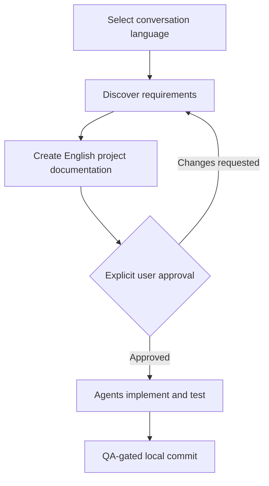

# Start here — Exelia Ultimate Starter

**Your first project: from ZIP to a Codex discovery session.**

[← Overview](README.md) · [Troubleshooting](docs/installer/TROUBLESHOOTING.md) · [Start prompt](START_NEW_PROJECT.md)

> [!TIP]
> **Expected time and cost:** The process downloads project-local tools and skills. Installation time and any network/API cost depend on the host, provider services and your existing setup; the starter does not estimate them.

## Before you begin

| Requirement | Check | Why it matters |
| :--- | :--- | :--- |
| macOS + OrbStack | Preferred, not required on Linux/WSL2 | Local container environment |
| Python 3.11+ | `python3 --version` | Starter installer |
| Node.js 20+ and npm | `node --version && npm --version` | Local frontend tools |
| Git | `git --version` | First local checkpoint |
| Codex CLI | `codex --version` | Agent workflow |
| Docker engine / OrbStack | `docker info` | Runtime for applicable projects |

The starter **checks** these host prerequisites but **does not install or upgrade them**.

## Step 1 / Extract into an empty folder

Unzip the complete starter into a fresh directory, then open a terminal there.

```bash
cd /path/to/your/new-project
ls -a
```

You should see at least `install.sh`, `.agents/`, `.codex/` and `START_NEW_PROJECT.md`.

> [!IMPORTANT]
> **Do not overlay this ZIP onto an existing application or an earlier starter version.** It is a standalone package. Keep your existing projects separate.

## Step 2 / Inspect before installation

```bash
./install.sh --check
./install.sh --plan
```

- `--check` shows host tools, project-local dependencies, skills, MCP configuration and Git state.
- `--plan` lists what can be installed locally and what needs manual action.
- Both modes are **read-only**.

**Expected:** missing skills on a fresh extraction are normal. `MCP CONFIGURED` means a project definition exists, **not** that authentication is complete.

## Step 3 / Install locally

```bash
./install.sh --apply
```

Read the plan, then approve it if correct. For Git identity, provide author details when requested. The identity is set for **this repository only**.

| Installed item | Destination |
| :--- | :--- |
| External skills, Ponytail | `.agents/skills/` |
| Node developer tools | `.exelia-tools/node/` |
| Python developer tools (`uv`, `ruff`) | `.exelia-tools/python/` |
| Bundled Rich installer UI | `installer/_vendor/` |
| Git baseline | `.git/` |

**No global npm installs, Homebrew changes or global Codex plugin installations are performed.**

### If the installer reports `PARTIAL`

After a fresh install only **core** skills are required. Project-specific tools, including Impeccable, are selected after stack discovery. A later `PARTIAL` status can still result from the interactive **Impeccable skill** installation. Finish it manually:

```bash
./scripts/local-tool.sh impeccable install
```

Choose **Codex → Project**. Then:

```bash
./install.sh --resume
```

A local `impeccable-cli` marked `READY` does **not** mean its project skill is installed. See the [troubleshooting guide](docs/installer/TROUBLESHOOTING.md) for other cases.

## Step 4 / Verify

```bash
./install.sh --verify
```

**Look for:** local tools and skills marked `READY`, a completed Git baseline and a clear next-action summary.

You can also inspect the last report or Git baseline:

```bash
./install.sh --report
git status --short
git log -1 --oneline
```

> [!NOTE]
> `--verify` checks local configuration and installation state. To confirm an MCP actually responds or a custom agent really spawns, you must test it from an authenticated Codex session.

## Step 5 / Open Codex and begin discovery

On **macOS**, copy the startup prompt:

```bash
cat START_NEW_PROJECT.md | pbcopy
codex
```

Paste the prompt into Codex. On other operating systems, open the file and copy its contents manually.

The first response must ask your conversation language: **Polish or English**. Application code and technical documentation stay **English**, independently of the conversation language; app UI language is decided later.



**Do not approve documents until they accurately describe the application you want to build.** Only one explicit approval is required before implementation; ordinary work stages do not need repeated approvals within the configured sandbox.

## When you return to the project

From the project folder, start Codex and paste [`CONTINUE_PROJECT.md`](CONTINUE_PROJECT.md). It instructs Codex to inspect actual files, project state and Git evidence before continuing.

---

### Need help?

- **Impeccable, skills, `PARTIAL` or MCP:** [Troubleshooting](docs/installer/TROUBLESHOOTING.md)
- **Global Ponytail asks to trust hooks:** [Ponytail and trust](docs/installer/PONYTAIL.md)
- **Environment differs from macOS:** [Supported platforms](docs/installer/PLATFORMS.md)
- **Restore previous local settings:** [Rollback](docs/installer/ROLLBACK.md)

## Step 6 / After approval: enable only relevant tools

A fresh 2.1 starter installs **core skills only**. Once discovery and the documentation approval are complete, record the selected stack and any required `capabilities.visual_qa` / `capabilities.security_review` flags in `project.config.json` and run:

```bash
python3 -m exelia capabilities plan --qa --security
./install.sh --plan
./install.sh --resume
python3 -m exelia capabilities freeze --qa --security
python3 -m exelia dispatch plan
```

The capability lock records local file hashes, not upstream source attestations. See [Automation](docs/automation/README.md) for worktrees, quality gates, visual QA and evaluations. To create a new project from GitHub, prefer [Use this template](docs/GITHUB_SETUP.md).
