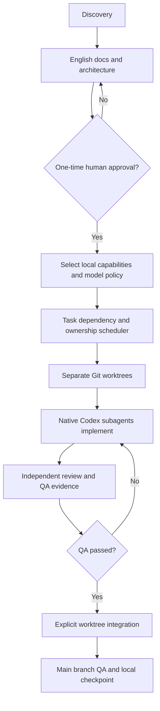

# Approved-project delivery workflow — 2.1.1



## 1. Approve once

Use `python3 scripts/project-state.py approve --evidence 'exact user confirmation'` **only** after verifying full English docs and receiving the human's actual approval. The script cannot authenticate who supplied evidence.

## 2. Select stack and local capabilities

Update `project.config.json` to the approved frontend/backend/database choices. Set `capabilities.visual_qa` and `capabilities.security_review` to `true` only if needed. `--qa` / `--security` on the resolver are temporary read-only selectors; persistent installer selection follows the config. Run:

```bash
python3 -m exelia capabilities plan --qa --security
./install.sh --plan
./install.sh --resume
python3 -m exelia capabilities freeze --qa --security
```

`--qa` and `--security` are task selectors, not a request for every skill. External skills are installed only through the existing local installer after explicit plan approval. Freeze requires every selected local skill to be installed. Audit compares selected and installed names, optional selectors, recorded sources and SHA-256 content snapshots. Re-run freeze with the same selectors after an intentional stack change or reviewed update; do not overwrite a lock merely to hide unexplained drift. Content hashes alone do not authenticate upstream source. Pinned source commits and package locks are recorded in `manifests/dependency-provenance.json`; supplier, advisory, licensing and cross-platform verification limits remain in the release audit.

## 3. Plan and assign independent work

Use `scripts/task-ledger.py add` to specify **nonoverlapping real file ownership** (`--scope frontend/src`), dependencies and acceptance criteria. Then:

```bash
python3 -m exelia dispatch plan
python3 -m exelia dispatch prepare
```

An empty or fully dependency-blocked queue is a successful no-op: zero tasks are prepared and no task worktrees or packets are created.

Scope paths are repository-relative. `api/src`, `api/./src` and `api//src` share ownership; parent/child paths conflict. Traversal and symlinks escaping the repository are rejected. Case aliases are conservatively serialized even on case-sensitive hosts.

`prepare` creates `.exelia/worktrees/TASK` and records tasks as in progress. Commit tracked task-ledger changes locally before future preparations. Spawn **native Codex custom subagents** using the generated task packets; set each agent's working folder to its assigned worktree. The CLI itself does not start agents, and project-scope strings are advisory unless agents are separately sandboxed.

## 4. Review, quality and integration

- Require independent review and record actual evidence for the exact committed task branch.
- Execute approved app QA, `python3 -m exelia visual run` if configured, and security checks when applicable.
- Mark tasks `ready_for_review` using `scripts/task-ledger.py review ID`, then record the review:

  ```bash
  python3 scripts/task-ledger.py attest-review TASK --reviewer code-reviewer --commit EXACT_TASK_COMMIT --result PASS --evidence docs/reviews/TASK.md
  ```

  The evidence file must exist within the repository. The reviewer identifier must differ from the owner. The record includes a timezone-aware timestamp and outstanding findings (`--finding` for a failing review). Integration/completion require PASS with no outstanding findings; later task source commits make the attestation stale. This is a procedural assertion, not authenticated proof of reviewer identity or review quality.
- `python3 -m exelia worktrees integrate ID` performs a **read-only check**; add `--confirm` for explicit merge only if main and task worktrees are clean and branch QA passes.
- Sequential tasks without a registered worktree attest the exact current main commit. Their evidence must use `docs/reviews/*.md`, `docs/reviews/*.txt`, or a root `review*.md` file. At completion only, subsequent linear commits changing exclusively `tasks/backlog.json` and that same evidence file may preserve the source review. Any other changed path or intervening merge makes it stale. This narrow metadata exception avoids a circular review-record commit; it does not apply to worktree integration.
- Run quality gates **again** on merged main. Integration currently leaves conflict resolution and merge rollback to the operator; there is no automatic conflict resolution or forced reset.
- Complete the task through the existing ledger with actual evidence and commit the state locally.

## 5. Resume

State of tasks/approval is versioned in `tasks/`. Machine-specific worktrees and dispatch packets are deliberately ignored by Git in `.exelia/`. On another machine, prepare new worktrees from committed branches; this is **not** cross-machine state replication. Resume a Codex session through its own history tools; Exelia only supplies durable repository facts.

Blocked tasks resume through `python3 scripts/task-ledger.py resume TASK --evidence 'verified reason the blocker is resolved'`. The controlled `blocked → todo` transition preserves history and clears stale review data. It does not bypass dependencies or documentation approval.

## 6. Checkpoints

Use a passing quality gate and a reviewed explicit path scope or reviewed staged index. Never use a blanket working-tree stage for a task checkpoint. Reject unrelated staged changes and protected credential filenames at any depth. The installer's first clean baseline uses a source manifest; it must not capture arbitrary neighboring user files. Inspect `git status --short`, the staged paths and `git diff --cached --check` before committing.

```bash
bash scripts/git-checkpoint.sh --starter "fix: correct dispatch handling" exelia/dispatch.py tests/test_remediation_backend.py
bash scripts/git-checkpoint.sh --docs "docs: explain recovery" --staged
```

Path arguments must be exact regular-file paths, not directories; no `--` separator is required. `--staged` validates the reviewed index and refuses staged files with unstaged content differences. Unrelated pre-existing staged paths are rejected when supplying explicit paths. For the first baseline only, `--initial` requires no existing HEAD and reads the exact source inventory from `MANIFEST.sha256`; unlisted unignored files block bootstrap. It is not a general task checkpoint selector.

## 7. Fail-closed boundaries

No product code before approved docs. No integration while worktrees are dirty. Overlapping scopes are serialized. No automatic pushes/deployments. Visual QA and evaluation need actual test runs; otherwise report `NOT_RUN`.
