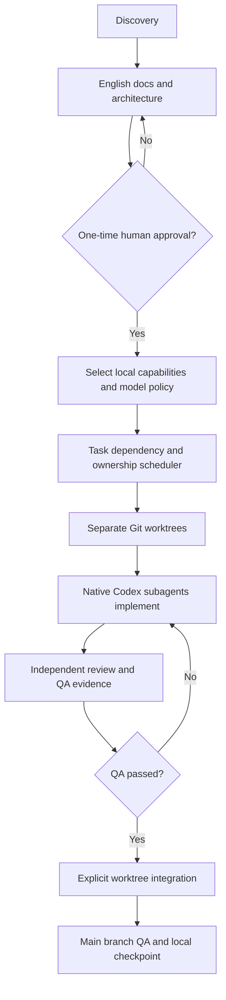

# Approved-project delivery workflow



## 1. Approve once

Use `python3 scripts/project-state.py approve --evidence 'exact user confirmation'` **only** after verifying full English docs and receiving the human's actual approval. The script cannot authenticate who supplied evidence.

## 2. Select stack and local capabilities

Update `project.config.json` to the approved frontend/backend/database choices. Set `capabilities.visual_qa` and `capabilities.security_review` to `true` only if needed. `--qa` / `--security` on the resolver are temporary read-only selectors; persistent installer selection follows the config. Run:

```bash
python3 -m exelia capabilities plan --qa --security
./install.sh --plan
./install.sh --resume
python3 -m exelia capabilities freeze --qa --security
```

`--qa` and `--security` are task selectors, not a request for every skill. External skills are installed only through the existing local installer after explicit plan approval. Missing upstream SHA pins are reported; freeze requires every selected local skill to be installed and captures content SHA-256 only. Use `python3 -m exelia capabilities audit` after cloning or updating to detect local drift.

## 3. Plan and assign independent work

Use `scripts/task-ledger.py add` to specify **nonoverlapping real file ownership** (`--scope frontend/src`), dependencies and acceptance criteria. Then:

```bash
python3 -m exelia dispatch plan
python3 -m exelia dispatch prepare
```

`prepare` creates `.exelia/worktrees/TASK` and records tasks as in progress. Commit tracked task-ledger changes locally before future preparations. Spawn **native Codex custom subagents** using the generated task packets; set each agent's working folder to its assigned worktree. The CLI itself does not start agents, and project-scope strings are advisory unless agents are separately sandboxed.

## 4. Review, quality and integration

- Require independent review and record actual evidence.
- Execute approved app QA, `python3 -m exelia visual run` if configured, and security checks when applicable.
- Mark tasks `ready_for_review` using `scripts/task-ledger.py review ID`.
- `python3 -m exelia worktrees integrate ID` performs a **read-only check**; add `--confirm` for explicit merge only if main and task worktrees are clean and branch QA passes.
- Run quality gates **again** on merged main. Integration currently leaves conflict resolution and merge rollback to the operator; there is no automatic conflict resolution or forced reset.
- Complete the task through the existing ledger with actual evidence and commit the state locally.

## 5. Resume

State of tasks/approval is versioned in `tasks/`. Machine-specific worktrees and dispatch packets are deliberately ignored by Git in `.exelia/`. On another machine, prepare new worktrees from committed branches; this is **not** cross-machine state replication. Resume a Codex session through its own history tools; Exelia only supplies durable repository facts.

## 6. Fail-closed boundaries

No product code before approved docs. No integration while worktrees are dirty. Overlapping scopes are serialized. No automatic pushes/deployments. Visual QA and evaluation need actual test runs; otherwise report `NOT_RUN`.
